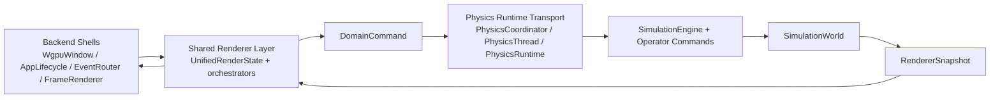

# Runtime Architecture

This document describes the target runtime architecture for the refactor track started in issue `#137`, the boundaries that are already implemented, and the transitional seams that still remain after the cleanup in issue `#147`.

It is not a sequencing document. For the implementation order of the refactor issues, see [refactor_architecture.md](refactor_architecture.md).

## Goals

The runtime refactor is driving toward four stable properties:

- application-level commands are expressed once and routed through a single boundary
- persistent simulation state is separated from stepping/runtime concerns
- renderer state is separated from renderer orchestration and backend-specific wiring
- backend entrypoints stay focused on windowing and rendering instead of owning simulation policy

## Layer Overview

The current target structure is:

```text
input/backend events
    ↓
renderer orchestrators and backend shells
    ↓
DomainCommand
    ↓
physics runtime / command transport
    ↓
simulation engine + operator commands
    ↓
simulation world state
    ↓
RendererSnapshot
    ↓
renderer orchestrators / backend frame submission
```

## Ownership Boundaries

### 1. Application Command Boundary

`DomainCommand` is the single application-level command contract produced by renderer-side code.

Responsibilities:

- represent user intent independently of backend details
- carry ball-management, simulation-control, resize, and operator actions
- give renderer code one stable interface for domain mutations

Current home:

- `core/src/application/domain_command.rs`

### 2. Persistent Simulation State

`SimulationWorld` is the single source of truth for the physical world state.

Responsibilities:

- own balls, physics configuration, spatial structures, and operator collections
- own simulation-facing stats and cached data derived from the world
- remain a pure state holder rather than a runtime or UI object

Current home:

- `core/src/application/core/mod.rs`

### 3. Simulation Stepping

`SimulationEngine` owns stepping and update behavior over the world state.

Responsibilities:

- neighbor collection and rebuild cadence
- force computation and integration updates
- thermostat/source/operator effects during a simulation step
- step-scoped stats updates and snapshot prerequisites

Current home:

- `core/src/application/core/simulation_engine.rs`

### 4. Physics Runtime

`PhysicsRuntime` owns thread-loop concerns, not the physics model itself.

Responsibilities:

- command draining
- sleep cadence / wait-time handling
- snapshot cadence and wakeups
- shutdown handling and performance reporting

Current home:

- `core/src/application/physics_thread/runtime.rs`

### 5. Renderer State And Orchestration

Renderer state is centered around `UnifiedRenderState`, but its internal responsibilities are now split between owned state and focused orchestrators.

Owned renderer state includes:

- viewport transform
- energy window state
- renderer configuration
- cursor/tool bookkeeping
- frame metrics and last snapshot

Orchestrator responsibilities include:

- frame lifecycle: `FrameOrchestrator`
- input and tool flow: `InputOrchestrator`
- resize and pan/zoom coordination: `ViewportOrchestrator`
- physics thread bridge: `PhysicsCoordinator`

Current home:

- `core/src/graphics/renderer/event_loop/`

### 6. Backend-Specific Wiring

The WGPU backend should own only backend wiring and frame submission.

Responsibilities:

- application shell and winit integration: `WgpuWindow`
- startup/bootstrap of window, context, pipelines, and shared state: `AppLifecycle`
- event classification and dispatch: `EventRouter`
- frame preparation and redraw handling: `FrameRenderer`

Current home:

- `wgpu_renderer/src/wgpu/`

## Dependency Direction

The intended dependency direction is one-way:

```text
backend shells
    → shared renderer/event-loop layer
        → DomainCommand
            → physics runtime transport
                → simulation engine / operator commands
                    → simulation world
```

That is the compile-time dependency direction.

The runtime command and snapshot flow is a separate concern. The following diagram is a data-flow view, not a compile-time dependency graph:



Read `Backend -> Renderer -> Domain -> Runtime -> Engine -> World` as the write path for user intent and `World -> RendererSnapshot -> Renderer -> Backend` as the read-only rendering path.

Important consequences:

- backend code should not encode simulation bootstrap or mutation policy
- renderer code should not mutate simulation state directly
- runtime code should not own renderer concerns
- world state should not depend on backend or UI types

## Command Flow

The current write path for simulation mutations is:

1. backend input is interpreted into renderer actions
2. renderer action processing emits `DomainCommand`
3. `PhysicsCoordinator` forwards the `DomainCommand` directly to the physics thread
4. `DomainCommandHandler` applies the command against `MainContent`
5. `SimulationEngine` and operator commands mutate the world state as needed

`DomainCommand` is the single command type used from input handling all the way through to the physics thread.

## Snapshot Flow

The current read path for rendering is:

1. the physics thread advances the simulation
2. `MainContent` publishes a `RendererSnapshot` into the shared snapshot slot
3. `PhysicsRuntime` triggers a backend wakeup callback
4. `PhysicsCoordinator` exposes the latest snapshot to renderer orchestrators
5. frame orchestration and backend frame submission consume the snapshot

This keeps rendering read-only with respect to the simulation world.

## Current Transitional Seams

The refactor is not fully converged yet. These seams still exist intentionally:

### `MainContent` remains a compatibility facade

`MainContent` still pairs `SimulationWorld` with physics-thread runtime bookkeeping and exposes the world through `Deref`/`DerefMut`.

Why it still exists:

- it preserves current physics-thread ownership and call sites while the split between state, stepping, and runtime stays incremental

Expected end state:

- narrower coordination surface once the remaining migration cleanup lands

### `SimulationEngine` still operates on `MainContent`

The engine owns stepping logic, but step entrypoints still start from `MainContent` because they need runtime-owned fields such as `GameLogicData`, logging, snapshot cadence, and source-emission ball creation. The pure world-mutation slice already runs on `SimulationWorld` directly.

Why it still exists:

- the remaining coupling is now limited to runtime-owned orchestration instead of the full physics update path

### `UnifiedRenderState` is still a facade

`UnifiedRenderState` is much smaller than before, but it still serves as the backend-facing surface over `RenderStateData` and the orchestrators.

Why it still exists:

- both backends need a stable shared renderer API while internal responsibilities are being decomposed

## Where New Logic Should Live

Use these placement rules when adding new behavior:

- add new user-intent commands at the `DomainCommand` boundary
- add new persistent simulation data to `SimulationWorld`
- add new per-step physics or world update logic to `SimulationEngine`
- add thread-loop, cadence, shutdown, or wakeup behavior to `PhysicsRuntime`
- add shared renderer coordination to the event-loop orchestrators, not backend shells
- add backend-specific rendering and event plumbing to `wgpu_renderer/src/wgpu/`
- add operator-specific mutations under `application/operator_command/`

Avoid these placements:

- do not put simulation policy in `main.rs` or backend entrypoints
- do not let renderer code mutate the world directly
- do not add new long-lived domain state to backend modules

## Relationship To Remaining Work

This document describes the target structure after issues `#144`, `#141`, `#145`, `#139`, `#140`, `#143`, `#138`, `#146`, and `#147`.

Issue `#147` removed the `DomainCommand` → `PhysicsCommand` runtime adapter so that `DomainCommand` is now the single command type from input handling all the way into the physics thread. The remaining transitional seams (`MainContent` as facade and `SimulationEngine` operating on `MainContent`) are intentional and can be tightened independently from the command path.

Contributors should treat the boundaries described here as the intended direction even when a thin facade still exists for compatibility.
